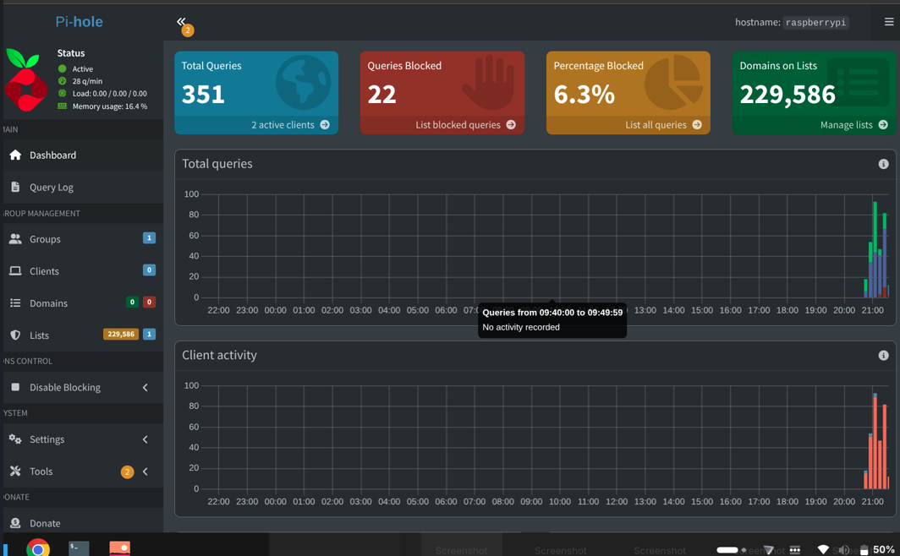
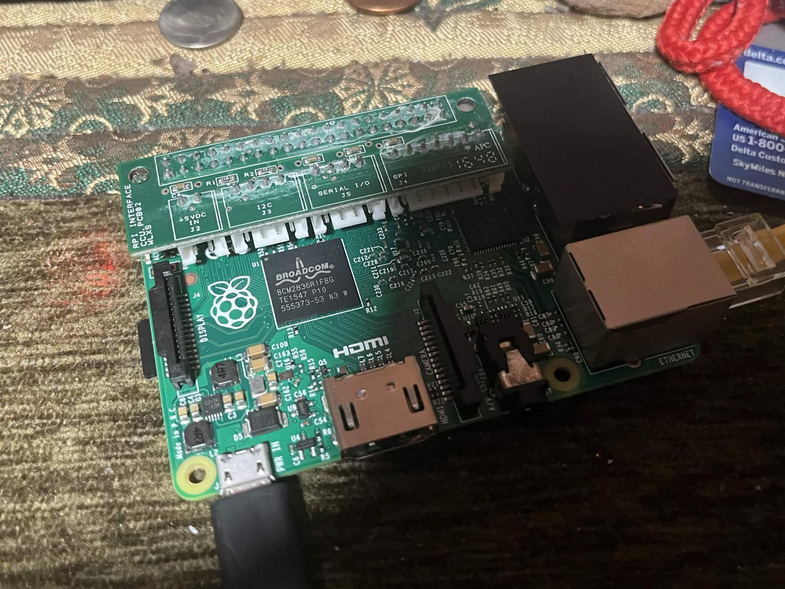

# Network-Wide DNS Sinkhole with Pi-hole

A headless, network-wide DNS ad blocker and telemetry filter deployed on a **Raspberry Pi 2 Model B** running **Raspberry Pi OS Lite (32-bit)**.

## Hardware & Software Stack
* **Single-Board Computer:** Raspberry Pi 2 Model B (900MHz Quad-Core ARMv7, 1GB RAM)
* **Power Supply:** Apple A1401 12W USB-A Power Adapter (5.2V / 2.4A) selected to prevent undervoltage during continuous 24/7 operation
* **Network Interface:** Wired RJ45 Ethernet (`eth0`) connected directly to the home router
* **Operating System:** Raspberry Pi OS Lite (32-bit) configured for headless SSH administration
* **DNS & Filtering Engine:** Pi-hole (`pihole-FTL`) with the OISD Big blocklist (`229,546` blocked domains)

## Network Architecture
```text
[Client Device (Linux Laptop)] 
        │  (DNS Queries via nmcli static DNS)
        ▼
[Raspberry Pi 2 Model B — Pi-hole] 
        ├──► Blocked Domains (229,546) ──► Sinkholed (0.0.0.0)
        └──► Allowed Domains ──► [Upstream DNS Resolver] ──► [Internet]
```

## Implementation & Troubleshooting Log
1. **Linux Storage & Hardware Verification:** Inspected block devices on a Linux workstation using `lsblk`, `watch -n 1 lsblk`, and `dmesg` to verify microSD card detection before flashing Raspberry Pi OS Lite (32-bit) with SSH enabled.
2. **Power & Thermal Stability:** Evaluated USB power adapters against the Raspberry Pi 2's 4.75V–5.25V operating threshold and deployed a 5.2V / 2.4A regulated supply to eliminate voltage drop risks.
3. **Headless Provisioning & DNS Diagnostics:** Connected over SSH, diagnosed initial `/etc/resolv.conf` DNS resolution issues during installation, and deployed Pi-hole.
4. **Gravity Blocklist & Client Routing:** Configured the `big.oisd.nl` blocklist (`229,546` domains) via Gravity and routed client traffic using Linux NetworkManager (`nmcli`) while disabling IPv6 DNS fallback (`ipv6.method disabled`) to prevent DNS leaks.
5. **Verification & Architectural Takeaways:** Verified domain sinkholing via the Pi-hole Query Log and `nslookup`, documenting key DNS-level boundaries such as encrypted DNS-over-HTTPS (DoH) and first-party streaming ads.

## Proof of Deployment

### Pi-hole Admin Dashboard


### Raspberry Pi 2 Hardware Setup


## Skills Demonstrated
* **Systems Administration:** Headless Linux server provisioning, SSH, `systemd`, `nmcli`, and storage diagnostics (`lsblk`, `dmesg`)
* **Networking:** DNS sinkholing, DHCP/static IP routing, IPv4/IPv6 DNS leak prevention, and packet/query log analysis
* **Documentation & Version Control:** Git CLI, GitHub repository management, and Markdown technical writing
